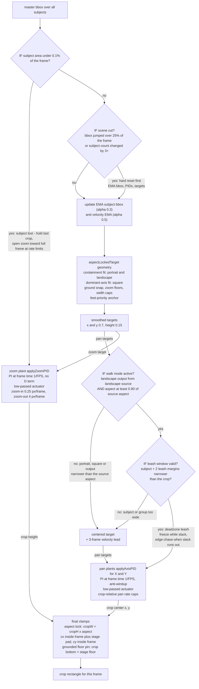

# TinyMikuServer

Server for streaming data to tiny Miku Holocube AI Assistant

## Overview

TinyMikuServer is a specialized video streaming server designed to serve content to the Tiny Miku Holocube AI Assistant. The project includes a custom binary video format (MikV), a streaming server, and utilities for video processing and conversion.

## Features

- **Custom MikV Format**: A lightweight binary format optimized for storing synchronized video and audio frames with DEFLATE compression
- **Streaming Server**: HTTP-based server for real-time streaming of MikV content
- **Video Converter**: Tool to convert MP4 files to the MikV format
- **HoloCropper**: Content-aware video cropping tool for preparing hologram-style videos at any output aspect ratio (1:1, portrait, landscape), with auto-orient and walk mode
- **Optimized for Edge Devices**: Designed for efficient streaming to embedded systems and IoT devices

## Project Structure

```
TinyMikuServer/
├── main.go                 # Main server application
├── HIGH-ASPECT-RATIO-FIXES.md  # HoloCropper framing design notes and measurements
├── pkg/
│   ├── mikvformat/        # MikV format library
│   │   ├── MikVFormat.go  # Core format implementation
│   │   └── cmd/
│   │       └── mikv-converter/  # MP4 to MikV converter CLI
│   ├── mikvserver/        # HTTP streaming server
│   │   ├── MikVServer.go  # Server implementation
│   │   └── server.go      # HTTP handlers
│   └── holocropper/       # Video cropping utility
│       ├── holocropper.go # Core cropping logic
│       └── cmd/
│           └── holocropper/     # HoloCropper CLI
├── bin/                   # Compiled binaries (generated)
└── assets/                # Video assets (not tracked)
    ├── mp4/              # Processed MP4 files
    ├── mp4-full/         # Original full videos
    └── mikv/             # Converted MikV files
```

## Prerequisites

- Go 1.24.1 or later
- FFmpeg (for video processing)

## Installation

### Using Go Install

```bash
go install github.com/Luigi-Pizzolito/TinyMikuServer@latest
```

### Building from Source

1. Clone the repository:
```bash
git clone https://github.com/Luigi-Pizzolito/TinyMikuServer.git
cd TinyMikuServer
```

2. Build all components:
```bash
make all
```

This will compile:
- `bin/TinyMikuServer` - Main streaming server
- `bin/mikv-converter` - MP4 to MikV converter
- `bin/holocropper` - Video cropping tool

### Building Individual Components

```bash
# Build only the server
make build-server

# Build only the converter
make build-mikv-converter

# Build only the holocropper
make build-holocropper
```

## Usage

### 1. Running the Server

The main server loads a MikV file and streams it over HTTP:

```bash
./bin/TinyMikuServer
```

By default, it:
- Loads `./assets/mikv/39.mikv`
- Starts HTTP server on port 8000

### 2. Converting Videos to MikV Format

Convert a single MP4 file:

```bash
./bin/mikv-converter -i input.mp4 -o ./output
```

Convert all MP4 files in a directory:

```bash
./bin/mikv-converter -i ./videos -o ./output
```

Options:
- `-i`: Input MP4 file or directory (default: current directory)
- `-o`: Output directory for MikV files (default: current directory)
- `-sampleRate`: Audio sample rate (default: 16000)
- `-channels`: Number of audio channels (default: 1)
- `-bitsPerSample`: Audio bits per sample (default: 16)
- `-silent`: Disable verbose output

### 3. Cropping Videos with HoloCropper

HoloCropper performs content-aware cropping suitable for holographic displays. Any output aspect ratio works - 1:1, tall portrait `200x648`, wide landscape `648x200` - framing is aspect-locked to the requested output:

```bash
./bin/holocropper -i input.mp4 -o ./output -w 240 -h 240 -fps 20    # 1:1
./bin/holocropper -i input.mp4 -o ./output -w 200 -h 648 -fps 24    # portrait
./bin/holocropper -i input.mp4 -o ./output -w 648 -h 200 -fps 24 -auto-orient
```

Options:
- `-i`: Input video file or directory
- `-o`: Output directory (required)
- `-w`: Width of cropped video (default: 240)
- `-h`: Height of cropped video (default: 240)
- `-fps`: Frames per second (default: 20)
- `-analysis-height`: Internal analysis frame height (0 = default 480, never below `-h`)
- `-zoom-margin`: Subject bbox padding factor (0 = default 1.12; landscape and portrait fits enforce a 1.18 padding floor)
- `-max-zoom`: Maximum zoom-in factor (0 = default 2.0)
- `-auto-orient`: Pick portrait (`HxW`) or landscape (`WxH`) output orientation from the subjects' aspect ratios; skipped for 1:1 outputs

Setting `HOLOCROPPER_DEBUG_BOXES=boxes.csv` writes a per-frame framing log (subject box, smoothed box, applied crop) for verification.

#### Auto-orient (`-auto-orient`)

Give any output resolution - e.g. `-w 648 -h 200` - and let the cropper pick the orientation for you. A preprocessing probe decodes up to 128 evenly spread frames of the input through the same subject-detection machinery the cropper uses, measures each frame's **master bounding box** (one box covering ALL detected subjects), and averages those aspect ratios. The requested `WxH` is compared with its transpose `HxW` by containment score and the better orientation is rendered.

- Tall solo subjects flip a landscape request to portrait; side-by-side groups flip a portrait request to landscape.
- The video is never rotated or flipped: only the crop orientation transposes, and the source always stays upright.
- `1:1` outputs bypass the probe completely (there is no portrait/landscape choice to make).
- The flag is opt-in. Without it `-w`/`-h` are used exactly as requested, so you can still render a portrait and a landscape version of the same video by hand. A probe failure or a subjectless video falls back to the requested orientation.

#### Walk mode (landscape to landscape)

When a landscape source video is cropped to a landscape output, the subject's left/right choreography is *kept* instead of being tracked away: the crop locks its horizontal position and the subject visibly walks left and right across the output frame, just like in the source. The crop only pans when the walk runs out of slack, and then it follows continuously (a deadzone leash - freeze, edge-chase, no bang-bang switching, no jitter).

- Always on - no flag. It activates when the output aspect is as wide as or wider than the source aspect (with a small leniency), e.g. 16:9, 16:10 or `648x200` output from a 16:9 source. Portrait, square and 1:1 outputs are untouched: their close crops have no slack to walk in anyway.
- The subject never walks off screen: a leash margin keeps her inside the crop edges while she walks, and the crop itself never leaves the frame (or its stage-padding allowance).
- If the output aspect is *narrower* than the source aspect (e.g. 4:3 output from a 16:9 source), the source's full walk range cannot fit the output width, so centered follow-tracking is kept, exactly as before.
- If the subject (or a side-by-side group) is wider than the crop minus two margins, those frames automatically fall back to centered tracking with velocity lead.
- Landscape crops always keep empty stage padding on the left and right (1.18 padding floor), so subjects and groups never graze or crop at the output's L/R edges - "like the headroom on top".

#### Architecture

`pkg/holocropper` is a channel-connected pipeline: one goroutine per stage (the six `STEP`s), each consuming from the previous frame queue, so a video streams through in one pass. `cmd/holocropper` only sets parameters and calls `Crop`.

```mermaid
flowchart LR
  CLI["cmd/holocropper<br/>-w -h -fps flags"] --> CROP["HoloCropper.Crop"]
  CROP --> ORIENT{"IF -auto-orient set?"}
  ORIENT -- "yes: probe up to 128 frames,<br/>keep or flip W x H by subject AR" --> SCALE["ffmpeg pre-scale<br/>analysis video, height 480 default"]
  ORIENT -- "no: use requested W x H" --> SCALE
  SCALE --> S1["STEP 1 readVideo<br/>raw RGBA frames"]
  S1 -- "raw frames" --> S2["STEP 2 grayscaleVideo"]
  S2 -- "gray frames" --> S3["STEP 3 binaryVideo<br/>Otsu with +/-10 hysteresis<br/>connected components<br/>20% area filter + combineBounds"]
  S3 -- "subject bboxes" --> S4["STEP 4 calcVideo<br/>framing controller<br/>(diagram below)"]
  S4 -- "crop rectangles" --> S5["STEP 5 crop frames"]
  S5 -- "cropped frames" --> S6["STEP 6 save JPEG frames"]
  S6 -- "JPEG sequence" --> MUX["ffmpeg mux<br/>frames + source audio<br/>output mp4"]
  S4 -. "debug hook: HOLOCROPPER_DEBUG_BOXES" .-> CSV["per-frame framing CSV"]
```



STEP 4 owns every per-frame framing decision: subject smoothing, the aspect-locked target geometry, and three plant controllers (pan X, pan Y, zoom):



- Dropout (no subject detected): the last crop is held and opens gradually toward full frame at rate limits - no snap.
- Zoom floors: never upscale past source resolution (absolute); the `maxZoom` policy floor relaxes for landscape, where the containment fit wins.
- Every controller plant is PI stepping at frame time (1/FPS) with a low-passed actuator command, so all crop motion is a smooth ramp - deterministic run to run.

Design and measured results: [HIGH-ASPECT-RATIO-FIXES.md](HIGH-ASPECT-RATIO-FIXES.md).

<details>
<summary>Key differences vs the original 1-1-Content-Aware-Video-Crop algorithm</summary>

The original algorithm (https://github.com/Luigi-Pizzolito/1-1-Content-Aware-Video-Crop) targeted 1:1 output only and left visible artifacts at other ratios. This rework:

- **Any output aspect ratio.** Framing is aspect-locked to the requested output. The original fixed the analysis frame to `Height x 16/9` and a square crop, so a 648x200 output analyzed a 356x200 frame and guaranteed 292+ px of padding; extreme ratios jittered and filled with black bars (measured: bars up to 372 px on 200x648).
- **No black padding on portrait/square.** Crop rectangles are clamped inside the frame and scaled to exactly fill the output, replacing the old expand-only rectangle + fit-resize that letterboxed with black. Landscape may extend the crop past the frame's left/right edges as black stage padding (up to a full-frame-height crop, ~41% per side on 648x200); vertical padding never occurs.
- **Fixed PID.** The original `Update()` computed `dt` from wall-clock epoch seconds, and its gains were calibrated against that bug. The new controller is pure PI stepping at frame time (1/FPS) - derivative kicks were a measured jitter source on real footage - with anti-windup, low-passed actuator commands, crop-relative pan rate caps, a smoothed velocity-lead on the pan targets, a deadband, continuous target EMAs, and a fast-retarget allowance gated to reacquisition after subject loss. Behaviour is deterministic and reproducible.
- **Subject now fills the frame.** The original could only zoom out, never in (coverage 50-75% on portrait). The new zoom floors (never upscale past source resolution, policy `maxZoom`) give 82-87% subject-height coverage on portrait (89% median) while 1:1 mode keeps the original ~88% look.
- **Landscape framing contains the whole subject, anchored on the floor.** For ratios like 648x200 the zoom window is sized to hold the entire body - head and feet, even in arm-raised poses - and its bottom is pinned to the stage floor. Subjects standing near the floor are ground-snapped (the fit extends to the floor even when the mask misses dark footwear), and grounded crops pin their bottom to the floor exactly. The crop can always grow to the full frame height, spilling past the left/right edges as black stage padding. The landscape fit enforces a minimum zoom margin (1.18): the crop is always wider than the subject, so dancers and groups never graze the output's left/right edges. The original left a constant ~150 px empty strip above the head and cut the legs.
- **Smoother tracking.** EMA subject bounding box with scene-cut reset, Otsu threshold hysteresis, and no unsharp filter on the analysis stream. Dropout holds the last framing and opens gradually instead of the original `panAdj = 0` hard snap (single-frame jumps up to 71 px in 1:1 mode).
- **Tall ratios contain, anchored on the feet.** Portrait crops (e.g. 200x648) contain the whole subject and anchor it so the feet sit just above the bottom edge with a small pad and the slack above the head - a real-corpus sweep showed any tighter fit clips the feet on most floor-standing frames.
- **Faster.** 25-30% faster on portrait and 1:1 despite larger analysis frames; landscape pays a small increase for the larger analysis frame that removes its structural padding.
- **Auto-orient probe (`-auto-orient`).** Estimates the average master-bbox aspect ratio of the subjects and renders the requested resolution or its transpose, whichever keeps them best framed. Never rotates the video; bypassed for 1:1. The original had no equivalent - the output orientation was fixed by the caller.
- **Walk mode (landscape to landscape).** A continuous deadzone pan leash: the crop holds its horizontal position so the subject walks left/right in the output exactly as she does in the source, panning smoothly only when the walk runs out of slack. The subject can never cross a screen edge. Active whenever the output aspect is at least as wide as the source aspect; portrait/square framing untouched. The original always centered the subject, which made dancing subjects appear stationary.
- **Tooling the original had none of:** 36 unit tests on the framing controller, geometry, walk-mode leash, and the auto-orient estimator, a CSV instrumentation hook for ground-truth verification, and CLI-tunable framing parameters.

</details>

### 4. Complete Workflow with Make

Process full videos through the entire pipeline:

```bash
# Step 1: Crop full videos to 1:1 aspect ratio
make convert-full

# Step 2: Convert cropped MP4s to MikV format
make convert-assets

# Or do both in one command:
make full-convert-assets
```

## MikV File Format Specification

The MikV format is a custom binary format optimized for synchronized video and audio streaming.

### Recommended Settings

- **FPS**: 20
- **Video Resolution**: 240×240
- **Audio Sample Rate**: 16000 Hz
- **Audio Channels**: 1 (mono)
- **Audio Bits per Sample**: 16
- **Compression**: DEFLATE (zlib)

### File Structure

```
[HEADER (16 bytes)] → [FRAME 1] → [FRAME 2] → ... → [FRAME N]
```

#### Header Format (16 bytes)

| Offset | Size | Type   | Description                  |
|--------|------|--------|------------------------------|
| 0      | 4    | bytes  | Magic number "MikV"          |
| 4      | 1    | uint8  | Frames per second (FPS)      |
| 5      | 2    | uint16 | Video frame height           |
| 7      | 2    | uint16 | Video frame width            |
| 9      | 2    | uint16 | Audio sample rate            |
| 11     | 1    | uint8  | Audio channels               |
| 12     | 2    | uint16 | Audio bits per sample        |
| 14     | 2    | uint16 | Reserved (padding)           |

#### Frame Structure

Each frame contains:
- **Video Size** (4 bytes): uint32 - Size of compressed video data
- **Video Data** (variable): DEFLATE compressed RGB565 frame
- **Audio Data** (fixed): Raw PCM audio samples

## API Reference

### MikVFormat

```go
// Create a new MikV format instance
mikv := mikvformat.NewMikVFormat()

// Load from file
mikv.Load("path/to/file.mikv")

// Save to file
mikv.Save("path/to/output.mikv")

// Create from MP4
mikv.FromMP4("path/to/video.mp4")

// Stream frames
frameChan := make(chan mikvformat.MikVFrame)
mikv.Stream(frameChan, nil)
```

### MikVServer

```go
// Create and start server
server := mikvserver.NewMikVServer()
server.Start(8000) // Optional port parameter

// Stream frames to connected clients
server.Stream <- frame

// Stop server
server.Stop()
```

### HoloCropper

```go
// Create cropper instance
cropper := holocropper.NewHoloCropper()

// Crop a video: height, width, fps, input, output directory
cropper.Crop(648, 200, 24.0, "input.mp4", "output")

// Optional: let the cropper pick portrait or landscape from subject AR
outW, outH, stats, err := cropper.AutoOrient("input.mp4", 648, 200) // chosen dims + probe stats
```

## Development

### Running Tests

```bash
go test ./...
```

### Cleaning Build Artifacts

```bash
make clean
```

## License

This project is licensed under the MIT License - see the [LICENSE](LICENSE) file for details.

Copyright (c) 2025 Luigi Pizzolito

## Contributing

Contributions are welcome! Please feel free to submit a Pull Request.

## Acknowledgments

- Built with [Vidio](https://github.com/AlexEidt/Vidio) for video processing
- Uses [progressbar](https://github.com/schollz/progressbar) for CLI feedback
- HoloCropper is a refactor of [1-1-Content-Aware-Video-Crop](https://github.com/Luigi-Pizzolito/1-1-Content-Aware-Video-Crop)
