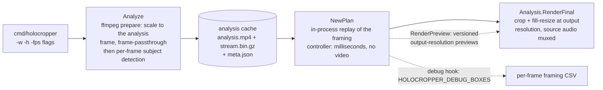
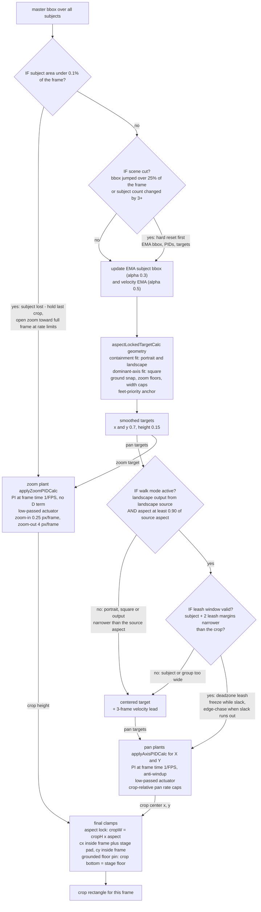

# TinyMikuServer

Server for streaming data to tiny Miku Holocube AI Assistant

## Overview

TinyMikuServer is a specialized video streaming server designed to serve content to the Tiny Miku Holocube AI Assistant. The project includes a custom binary video format (MikV), a streaming server, and utilities for video processing and conversion.

## Features

- **Custom MikV Format**: A lightweight binary format optimized for storing synchronized video and audio frames - DEFLATEd RGB565 video with raw PCM audio by default, with header-recorded payload encodings for JPEG video (MJPEG-in-MikV) and OGG-Opus audio
- **Streaming Server**: HTTP-based server for real-time streaming of MikV content
- **Video Converter**: Tool to convert MP4 files to the MikV format, including `-jpeg` and `-opus` payload encodings
- **HoloCropper**: Content-aware video cropping tool for preparing hologram-style videos at any output aspect ratio (1:1, portrait, landscape), with auto-orient and walk mode - plus a **fit mode** (`-fit`) for non-hologram videos: whole-frame scale-to-fit with black bars - and **MikV output** (`-mikv`) that writes the firmware container straight from the render, MJPEG+OGG-Opus pairing included
- **Optimized for Edge Devices**: Designed for efficient streaming to embedded systems and IoT devices

## Project Structure

```
TinyMikuServer/
├── main.go                 # Main server application
├── HIGH-ASPECT-RATIO-FIXES.md  # HoloCropper framing design notes and measurements
├── pkg/
│   ├── mikvformat/        # MikV format library
│   │   ├── MikVFormat.go  # Core format implementation
│   │   ├── ogg_opus.go    # OGG-Opus per-frame segmentation
│   │   └── cmd/
│   │       └── mikv-converter/  # MP4 to MikV converter CLI
│   ├── mikvserver/        # HTTP streaming server
│   │   ├── MikVServer.go  # Server implementation
│   │   └── server.go      # HTTP handlers
│   └── holocropper/       # Video cropping utility
│       ├── analysis.go    # Analyze pass (prepare + detect, cached)
│       ├── plan.go        # NewPlan: in-process framing replay
│       ├── renders.go     # RenderPreview / RenderFinal passes
│       ├── mikv.go        # RenderMikV pass (MikV container output)
│       └── cmd/
│           └── holocropper/     # HoloCropper CLI (drives those passes)
├── bin/                   # Compiled binaries (generated)
└── assets/                # Video assets (not tracked)
    ├── mp4/              # Processed MP4 files
    ├── mp4-full/         # Original full videos
    └── mikv/             # Converted MikV files
```

## Prerequisites

- Go 1.24.1 or later
- FFmpeg (for video processing)

## Installation

### Using Go Install

```bash
go install github.com/Luigi-Pizzolito/TinyMikuServer@latest
```

### Building from Source

1. Clone the repository:
```bash
git clone https://github.com/Luigi-Pizzolito/TinyMikuServer.git
cd TinyMikuServer
```

2. Build all components:
```bash
make all
```

This will compile:
- `bin/TinyMikuServer` - Main streaming server
- `bin/mikv-converter` - MP4 to MikV converter
- `bin/holocropper` - Video cropping tool

### Building Individual Components

```bash
# Build only the server
make build-server

# Build only the converter
make build-mikv-converter

# Build only the holocropper
make build-holocropper
```

## Usage

### 1. Running the Server

The main server loads a MikV file and streams it over HTTP:

```bash
./bin/TinyMikuServer
```

By default, it:
- Loads `./assets/mikv/39.mikv`
- Starts HTTP server on port 8000

### 2. Converting Videos to MikV Format

Convert a single MP4 file:

```bash
./bin/mikv-converter -i input.mp4 -o ./output
```

Convert all MP4 files in a directory:

```bash
./bin/mikv-converter -i ./videos -o ./output
```

Options:
- `-i`: Input MP4 file or directory (default: current directory)
- `-o`: Output directory for MikV files (default: current directory)
- `-sampleRate`: Audio sample rate (default: 16000)
- `-channels`: Number of audio channels (default: 1)
- `-bitsPerSample`: Audio bits per sample (default: 16)
- `-jpeg`: Store video frames as JPEG (video encoding `0x01`, MJPEG-in-MikV) instead of DEFLATEd RGB565
- `-jpeg-quality`: JPEG quality for `-jpeg` frames (default: 90)
- `-opus`: Store audio as OGG-Opus cut into per-frame segments (audio encoding `0x01`) instead of raw PCM; forces `-sampleRate 48000`
- `-opus-bitrate`: libopus bitrate in kbps for `-opus` audio (default: encoder's own)
- `-silent`: Disable verbose output

Leaving `-jpeg`/`-opus` off produces the original encoding exactly. The firmware pairing for the compressed variants is **24 fps video + 48 kHz OGG-Opus audio** (40 ms packets).

### 3. Cropping Videos with HoloCropper

HoloCropper performs content-aware cropping suitable for holographic displays. Any output aspect ratio works - 1:1, tall portrait `200x648`, wide landscape `648x200` - framing is aspect-locked to the requested output. For **non-hologram videos** (normal full-frame 4:3/16:9 sources like MVs) the `-fit` flag replaces the content-aware crop with a whole-frame scale-to-fit on black bars:

```bash
./bin/holocropper -i input.mp4 -o ./output -w 240 -h 240 -fps 20    # 1:1
./bin/holocropper -i input.mp4 -o ./output -w 200 -h 648 -fps 24    # portrait
./bin/holocropper -i input.mp4 -o ./output -w 648 -h 200 -fps 24 -auto-orient
./bin/holocropper -i mv.mp4 -o ./output -w 240 -h 240 -fps 24 -fit  # non-hologram: fit + bars
```

Options:
- `-i`: Input video file or directory
- `-o`: Output directory (required)
- `-w`: Width of cropped video (default: 240)
- `-h`: Height of cropped video (default: 240)
- `-fps`: Frames per second (default: 20)
- `-analysis-height`: Internal analysis frame height (0 = default 480, never below `-h`)
- `-zoom-margin`: Subject bbox padding factor (0 = default 1.12; landscape and portrait fits enforce a 1.18 padding floor)
- `-max-zoom`: Maximum zoom-in factor (0 = default 2.0)
- `-auto-orient`: Pick portrait (`HxW`) or landscape (`WxH`) output orientation from the subjects' aspect ratios; skipped for 1:1 outputs. With `-fit` it instead picks the orientation with the least bars
- `-fit`: **Fit mode** for non-hologram videos: scale the whole frame to fit the output resolution, centered on black bars - no content-aware crop, no zoom
- `-mikv`: Write the final output as a **MikV container** (the firmware format) instead of mp4; the file is `<basename>-<WxH>.mikv`
- `-mikv-jpeg`: With `-mikv`: store video frames as JPEG (video encoding `0x01`, MJPEG-in-MikV) instead of DEFLATEd RGB565; `-jpeg-quality` sets the quality (default 90)
- `-mikv-opus`: With `-mikv`: store audio as OGG-Opus cut into per-frame segments (audio encoding `0x01`) instead of raw PCM; uses 48000 Hz audio, `-opus-bitrate` in kbps overrides the encoder default
- `-temp-dir`: Scratch + analysis-cache parent (default: the system temp dir). Cached analyses make repeated renders of an unchanged video skip the detect pass entirely
- `-ffmpeg-path`: Path to the ffmpeg binary (default: `ffmpeg` from `PATH`)

Output keeps the legacy naming: `<input basename>.mp4` in `-o`, overwritten on re-render (`-mikv` instead writes the dimension-tagged `<basename>-<WxH>.mikv`).

Setting `HOLOCROPPER_DEBUG_BOXES=boxes.csv` writes a per-frame framing log (subject box, smoothed box, applied crop) for verification.

#### Auto-orient (`-auto-orient`)

Give any output resolution - e.g. `-w 648 -h 200` - and let the cropper pick the orientation for you. The analysis pass already measures every frame's **master bounding box** (one box covering ALL detected subjects); the aspect ratios of those boxes are averaged and the requested `WxH` is compared with its transpose `HxW` by containment score, and the better orientation is rendered. The CLI prints the aggregates (frames with subjects, mean/geometric-mean/median AR, both coverage scores) for the decision it took.

- Tall solo subjects flip a landscape request to portrait; side-by-side groups flip a portrait request to landscape.
- The video is never rotated or flipped: only the crop orientation transposes, and the source always stays upright.
- `1:1` outputs bypass the decision completely (there is no portrait/landscape choice to make).
- The flag is opt-in. Without it `-w`/`-h` are used exactly as requested, so you can still render a portrait and a landscape version of the same video by hand. A subjectless video keeps the requested orientation.

#### Fit mode (`-fit`)

Not every job is a hologram crop. A normal music video or full-frame clip should keep its whole picture - it just needs to land in a different shape (16:9 source, square social output). `-fit` is that mode: the **whole frame is scaled aspect-preserving to fit inside the output resolution and centered, the rest filled with black bars** (letterbox/pillarbox). No subject detection drives the framing, nothing is cropped, nothing is zoomed.

- Detection still runs underneath: records, overlays, stills and metrics stay populated, and subject boxes map through the fit transform, so an overlay preview draws them at the right spot *inside* the bars.
- `-auto-orient` with `-fit` becomes pure geometry: the orientation whose aspect is closer to the source's gets fewer bars, and the CLI prints both bar coverages. Unlike crop-mode auto-orient, it decides the same way on videos with no detectable subjects.
- Matching aspects (e.g. 16:9 source to a 16:9-shaped target) produce an exact resize with no bars at all.
- The API entry points are `holocropper.NewFitPlan(...)` or `Settings{FitWithBars: true}`; previews and renders treat fit and crop plans as different products (their `SettingsHash` values never match). See [HOLOCROPPER-API-PLAN.md](HOLOCROPPER-API-PLAN.md) §6.10.

#### MikV output (`-mikv`)

The last step of the asset pipeline is usually `mikv-converter`. `-mikv` folds that step into the render: the planned frames are written straight into a MikV container, no intermediate mp4. The framing is identical to a normal render - crop, auto-orient, walk mode and fit mode all apply - only the output *container* changes.

```bash
./bin/holocropper -i mv.mp4 -o ./assets/mp4 -w 240 -h 240 -fps 20 -mikv                      # legacy encodings: DEFLATE RGB565 + raw PCM
./bin/holocropper -i mv.mp4 -o ./assets/mp4 -w 240 -h 240 -fps 24 -mikv -mikv-jpeg -mikv-opus  # MJPEG + OGG-Opus (40 ms packets at 48 kHz)
```

- The default output carries the original encodings (header bytes 13/14 = `0x00`/`0x00`): DEFLATEd RGB565 video, raw PCM at 16000 Hz mono 16-bit - exactly what the firmware reads today.
- `-mikv-jpeg` stores one complete JPEG per frame (video encoding `0x01`); `-mikv-opus` stores the audio as one ordinary OGG-Opus stream cut at page boundaries into one chunk per frame (audio encoding `0x01`). Concatenating a file's audio chunks reproduces a plain `.ogg` - a decoder needs no MikV knowledge to play it.
- MikV stores an integral frame rate: `-fps` must be whole. Raw PCM chunks are fixed-length (`sampleRate/fps` samples), so with PCM audio the sample rate must divide the fps; the recommended compressed pairing is **24 fps + 48 kHz**, where everything divides (40 ms Opus packets).
- The API entry point is `analysis.RenderMikV(ctx, plan, MikVRequest{...})` with `MikVOptions` selecting the encodings; it shares the render slot with previews and the mp4 render. See [HOLOCROPPER-API-PLAN.md](HOLOCROPPER-API-PLAN.md) §6.11.

#### Walk mode (landscape to landscape)

When a landscape source video is cropped to a landscape output, the subject's left/right choreography is *kept* instead of being tracked away: the crop locks its horizontal position and the subject visibly walks left and right across the output frame, just like in the source. The crop only pans when the walk runs out of slack, and then it follows continuously (a deadzone leash - freeze, edge-chase, no bang-bang switching, no jitter).

- Always on - no flag. It activates when the output aspect is as wide as or wider than the source aspect (with a small leniency), e.g. 16:9, 16:10 or `648x200` output from a 16:9 source. Portrait, square and 1:1 outputs are untouched: their close crops have no slack to walk in anyway.
- The subject never walks off screen: a leash margin keeps her inside the crop edges while she walks, and the crop itself never leaves the frame (or its stage-padding allowance).
- If the output aspect is *narrower* than the source aspect (e.g. 4:3 output from a 16:9 source), the source's full walk range cannot fit the output width, so centered follow-tracking is kept, exactly as before.
- If the subject (or a side-by-side group) is wider than the crop minus two margins, those frames automatically fall back to centered tracking with velocity lead.
- Landscape crops always keep empty stage padding on the left and right (1.18 padding floor), so subjects and groups never graze or crop at the output's L/R edges - "like the headroom on top".

#### Architecture

`pkg/holocropper` runs as three passes (surface, contract and rationale: [HOLOCROPPER-API-PLAN.md](HOLOCROPPER-API-PLAN.md)). Each pass is a cancellable Task reporting phase and progress; every scratch file lives under a caller-supplied temp dir; the analysis cache lets repeated work on an unchanged video skip detection entirely. `cmd/holocropper` is a thin front end over the same surface an embedding app uses.



`Analyze` measures one **master bbox** per frame (covering all detected subjects) and caches it. `NewPlan` replays the framing controller over those bboxes - so changing `-w`, `-h`, `-zoom-margin` or `-auto-orient` costs a millisecond-scale replay, not a re-decode - and `RenderFinal`/`RenderPreview` execute the plan's crop rectangles against the cached analysis video. The replay is provably the old pipeline's decision stream: `TestReplayParityVsDebugCSV` pins it, frame for frame, against the fused pipeline's own golden CSV - one golden per ffmpeg major version, since the decision stream follows that build's encode/decode behavior.

The framing controller owns every per-frame decision: subject smoothing, the aspect-locked target geometry, and three plant controllers (pan X, pan Y, zoom):



- Dropout (no subject detected): the last crop is held and opens gradually toward full frame at rate limits - no snap.
- Zoom floors: never upscale past source resolution (absolute); the `maxZoom` policy floor relaxes for landscape, where the containment fit wins.
- Every controller plant is PI stepping at frame time (1/FPS) with a low-passed actuator command, so all crop motion is a smooth ramp - deterministic run to run.

Design and measured results: [HIGH-ASPECT-RATIO-FIXES.md](HIGH-ASPECT-RATIO-FIXES.md).

<details>
<summary>Key differences vs the original 1-1-Content-Aware-Video-Crop algorithm</summary>

The original algorithm (https://github.com/Luigi-Pizzolito/1-1-Content-Aware-Video-Crop) targeted 1:1 output only and left visible artifacts at other ratios. This rework:

- **Any output aspect ratio.** Framing is aspect-locked to the requested output. The original fixed the analysis frame to `Height x 16/9` and a square crop, so a 648x200 output analyzed a 356x200 frame and guaranteed 292+ px of padding; extreme ratios jittered and filled with black bars (measured: bars up to 372 px on 200x648).
- **No black padding on portrait/square.** Crop rectangles are clamped inside the frame and scaled to exactly fill the output, replacing the old expand-only rectangle + fit-resize that letterboxed with black. Landscape may extend the crop past the frame's left/right edges as black stage padding (up to a full-frame-height crop, ~41% per side on 648x200); vertical padding never occurs.
- **Fixed PID.** The original `Update()` computed `dt` from wall-clock epoch seconds, and its gains were calibrated against that bug. The new controller is pure PI stepping at frame time (1/FPS) - derivative kicks were a measured jitter source on real footage - with anti-windup, low-passed actuator commands, crop-relative pan rate caps, a smoothed velocity-lead on the pan targets, a deadband, continuous target EMAs, and a fast-retarget allowance gated to reacquisition after subject loss. Behaviour is deterministic and reproducible.
- **Subject now fills the frame.** The original could only zoom out, never in (coverage 50-75% on portrait). The new zoom floors (never upscale past source resolution, policy `maxZoom`) give 82-87% subject-height coverage on portrait (89% median) while 1:1 mode keeps the original ~88% look.
- **Landscape framing contains the whole subject, anchored on the floor.** For ratios like 648x200 the zoom window is sized to hold the entire body - head and feet, even in arm-raised poses - and its bottom is pinned to the stage floor. Subjects standing near the floor are ground-snapped (the fit extends to the floor even when the mask misses dark footwear), and grounded crops pin their bottom to the floor exactly. The crop can always grow to the full frame height, spilling past the left/right edges as black stage padding. The landscape fit enforces a minimum zoom margin (1.18): the crop is always wider than the subject, so dancers and groups never graze the output's left/right edges. The original left a constant ~150 px empty strip above the head and cut the legs.
- **Smoother tracking.** EMA subject bounding box with scene-cut reset, Otsu threshold hysteresis, and no unsharp filter on the analysis stream. Dropout holds the last framing and opens gradually instead of the original `panAdj = 0` hard snap (single-frame jumps up to 71 px in 1:1 mode).
- **Tall ratios contain, anchored on the feet.** Portrait crops (e.g. 200x648) contain the whole subject and anchor it so the feet sit just above the bottom edge with a small pad and the slack above the head - a real-corpus sweep showed any tighter fit clips the feet on most floor-standing frames.
- **Faster.** 25-30% faster on portrait and 1:1 despite larger analysis frames; landscape pays a small increase for the larger analysis frame that removes its structural padding.
- **Auto-orient (`-auto-orient`).** From the analysis pass's own per-frame master bboxes, averages their aspect ratios and renders the requested resolution or its transpose, whichever keeps them best framed. Never rotates the video; bypassed for 1:1. The original had no equivalent - the output orientation was fixed by the caller.
- **Walk mode (landscape to landscape).** A continuous deadzone pan leash: the crop holds its horizontal position so the subject walks left/right in the output exactly as she does in the source, panning smoothly only when the walk runs out of slack. The subject can never cross a screen edge. Active whenever the output aspect is at least as wide as the source aspect; portrait/square framing untouched. The original always centered the subject, which made dancing subjects appear stationary.
- **Tooling the original had none of:** 100+ unit tests on the framing controller, geometry, walk-mode leash, the orientation estimator and the API passes, a golden decision-CSV parity test that pins the replay against the framing stream the corpus was tuned on, a CSV instrumentation hook for ground-truth verification, and CLI-tunable framing parameters.

</details>

### 4. Complete Workflow with Make

Process full videos through the entire pipeline:

```bash
# Step 1: Crop full videos to 1:1 aspect ratio
make convert-full

# Step 2: Convert cropped MP4s to MikV format
make convert-assets

# Or do both in one command:
make full-convert-assets
```

## MikV File Format Specification

The MikV format is a custom binary format optimized for synchronized video and audio streaming.

### Recommended Settings

- **FPS**: 20
- **Video Resolution**: 240×240
- **Audio Sample Rate**: 16000 Hz
- **Audio Channels**: 1 (mono)
- **Audio Bits per Sample**: 16
- **Compression**: DEFLATE (zlib)

For the compressed variants (JPEG video + OGG-Opus audio) the recommended pairing is **24 FPS + 48000 Hz audio** - the Opus packet duration then lands on exactly 40 ms per video frame.

### File Structure

```
[HEADER (16 bytes)] → [FRAME 1] → [FRAME 2] → ... → [FRAME N]
```

#### Header Format (16 bytes)

All integers are little-endian.

| Offset | Size | Type   | Description                  |
|--------|------|--------|------------------------------|
| 0      | 4    | bytes  | Magic number "MikV"          |
| 4      | 1    | uint8  | Frames per second (FPS)      |
| 5      | 2    | uint16 | Video frame height           |
| 7      | 2    | uint16 | Video frame width            |
| 9      | 2    | uint16 | Audio sample rate            |
| 11     | 1    | uint8  | Audio channels               |
| 12     | 1    | uint8  | Audio bits per sample        |
| 13     | 1    | uint8  | Video encoding               |
| 14     | 1    | uint8  | Audio encoding               |
| 15     | 1    | uint8  | Reserved (always zero)       |

Original MikV files wrote zeros into the reserved padding, so offsets 13-15 read as encoding `0x00` - the legacy encodings - for every pre-existing file. Readers must reject unknown encoding IDs: a payload read under the wrong encoding is silent garbage.

| Video encoding (byte 13) | Payload                                            |
|--------------------------|----------------------------------------------------|
| `0x00`                   | DEFLATE (zlib) compressed RGB565 frame (legacy default) |
| `0x01`                   | One complete JPEG image per frame (MJPEG-in-MikV)  |

| Audio encoding (byte 14) | Payload                                            |
|--------------------------|----------------------------------------------------|
| `0x00`                   | Raw interleaved PCM, `sampleRate / FPS` samples per frame (legacy default) |
| `0x01`                   | OGG-Opus page segments: the audio track is ONE ordinary Ogg Opus stream, cut at page boundaries into one chunk per video frame (variable-length; chunks may be empty). Concatenating every audio chunk in file order reproduces the original `.ogg` byte for byte |

#### Frame Structure

Each frame contains:
- **Video Size** (4 bytes): uint32 - Size of the encoded video data
- **Video Data** (variable): the payload per byte 13 of the header
- **Audio Size** (4 bytes): uint32 - Size of the encoded audio data
- **Audio Data** (variable): the payload per byte 14 of the header

## API Reference

### MikVFormat

```go
// Create a new MikV format instance
mikv := mikvformat.NewMikVFormat()

// Load from file (header encoding IDs are validated; frames carry
// VideoEncoding/AudioEncoding stamps)
mikv.Load("path/to/file.mikv")

// Save to file
mikv.Save("path/to/output.mikv")

// Create from MP4. Defaults: DEFLATE RGB565 + raw PCM. For the
// compressed variants set the encoding IDs first:
mikv.VideoEncoding = mikvformat.EncodingJPEG    // MJPEG-in-MikV
mikv.AudioEncoding = mikvformat.EncodingOGGOpus // 48 kHz granule clock
mikv.LoadFromMP4("path/to/video.mp4")

// Split one OGG-Opus stream into per-video-frame chunks (and back):
chunks, err := mikvformat.SplitOGGOpus(oggBytes, fps, frames)
ogg := mikvformat.JoinOGGChunks(chunks)

// Stream frames
frameChan := make(chan mikvformat.MikVFrame)
mikv.Stream(frameChan, nil)
```

### MikVServer

```go
// Create and start server
server := mikvserver.NewMikVServer()
server.Start(8000) // Optional port parameter

// Stream frames to connected clients
server.Stream <- frame

// Stop server
server.Stop()
```

The `/video` endpoint announces the file's payload encodings in the response
headers `X-Video-Encoding` and `X-Audio-Encoding` (the header byte 13/14
values), so clients pick the right decoder per frame. Encoding `0` is the
legacy default, so pre-existing clients see identical bytes.

### HoloCropper

The embeddable passes - the same surface `cmd/holocropper` drives:

```go
// Analyze: prepare (scaled analysis video) + detect (per-frame master bboxes),
// cached under TempDir for the life of the input file.
task, err := holocropper.Analyze(ctx, holocropper.AnalyzeRequest{
	Input: "input.mp4", TempDir: "./tmp",
})
analysis, err := task.Wait()

// Plan: replay the framing controller in-process. Re-plan after every setting
// change - milliseconds, no re-detection. Orientation rides on Settings.
plan, err := holocropper.NewPlan(analysis.Stream(), holocropper.Settings{
	Width: 648, Height: 200, FPS: 24, AutoOrient: true,
})
flip := plan.Orientation().Flip // chosen orientation + AR aggregates

// Fit mode (non-hologram videos, §6.10): the WHOLE frame scales into the
// output on black bars - no crop, no zoom. Previews and the final render
// below work on a fit Plan exactly as they do on a crop Plan.
fitPlan, err := holocropper.NewFitPlan(analysis.Stream(), holocropper.Settings{
	Width: 240, Height: 240, FPS: 24, FitWithBars: true, AutoOrient: true,
})

// Preview (versioned, output resolution) and the final render. Both are
// Tasks: Wait blocks, Observer/TaskInfo drive the spinner.
pvTask, err := analysis.RenderPreview(ctx, plan, holocropper.PreviewRequest{})
pv, err := pvTask.Wait() // <basename>-<WxH>-v<N>.mp4 inside the analysis cache

finalTask, err := analysis.RenderFinal(ctx, plan, holocropper.RenderRequest{
	OutputDir: "output", TempDir: "./tmp",
})
res, err := finalTask.Wait() // <basename>-<WxH>.mp4; OutputName overrides it

// MikV output (§6.11): the same planned frames written straight into the
// firmware container. Zero Options = the legacy encodings.
mikvTask, err := analysis.RenderMikV(ctx, plan, holocropper.MikVRequest{
	OutputDir: "output", TempDir: "./tmp",
	Options: holocropper.MikVOptions{
		VideoJPEG: true,          // header byte 13 = 0x01
		AudioOpus: true,          // header byte 14 = 0x01, 48 kHz
		OpusBitrateKbps: 32,
	},
})
mres, err := mikvTask.Wait() // <basename>-<WxH>.mikv; OutputName overrides it
```

## Development

### Running Tests

```bash
make test                              # everything CI runs (see below)
go test ./...                          # server + MikV packages
cd pkg/holocropper && go test ./...    # HoloCropper is a separate Go module
```

CI (`.github/workflows/ci.yml`) runs the holocropper suite with `-race` plus CLI smokes for legacy naming, fit mode and MikV output (header bytes checked raw on the rendered container), entirely on lavfi-synthesized fixture videos and the golden parity CSVs (one per ffmpeg major version, matched to the pinned CI image) - no corpus clips needed. It also runs the `pkg/mikvformat` suite, whose OGG-Opus tests encode real `ffmpeg -c:a libopus` streams. Set `HOLOCROPPER_REQUIRE_FFMPEG=1` to make a missing ffmpeg fail those tests instead of skipping them (CI sets it). If the pinned image's ffmpeg stops reproducing its golden, dispatch the CI workflow with `regenerate_golden=true` - it re-records the goldens on the runner's own ffmpeg build and uploads them as an artifact to review and commit (or run `HOLOCROPPER_REGENERATE_GOLDEN=1 go test -run TestReplayParityVsDebugCSV` locally with the ffmpeg you use).

### Cleaning Build Artifacts

```bash
make clean
```

## License

This project is licensed under the MIT License - see the [LICENSE](LICENSE) file for details.

Copyright (c) 2025 Luigi Pizzolito

## Contributing

Contributions are welcome! Please feel free to submit a Pull Request.

## Acknowledgments

- Built with [Vidio](https://github.com/AlexEidt/Vidio) for video processing
- Uses [progressbar](https://github.com/schollz/progressbar) for CLI feedback
- HoloCropper is a refactor of [1-1-Content-Aware-Video-Crop](https://github.com/Luigi-Pizzolito/1-1-Content-Aware-Video-Crop)
